# Práctica 04 – TokTik

**TokTik** es una aplicación móvil de videos verticales desarrollada con Flutter. Su interfaz organiza publicaciones en feeds temáticos, permite interactuar con ellas y adapta su presentación a temporadas del año.

| Dato | Información |
|---|---|
| Materia | Desarrollo Móvil Integral (DMI) |
| Estudiante | Carlos Daniel Garcia Pluma  (230187) |
| Carrera | Ingeniería en Desarrollo y Gestión de Software |
| Docente | MTI Marco A. Ramírez Hernández |

## Descripción y objetivo académico

La práctica consiste en construir una experiencia móvil de reproducción de videos breves y explorar, mediante Flutter y Dart, la composición de interfaces, la gestión reactiva del estado, la separación de responsabilidades por capas y el almacenamiento local de preferencias e interacciones.

## Características implementadas

- Reproducción de videos en pantalla completa, en bucle, con desplazamiento vertical entre publicaciones.
- Feeds **Discover**, **For You**, además de la sección **Favoritos**.
- Controles de reproducción, me gusta, favoritos y silencio de audio.
- Persistencia local de favoritos y videos vistos mediante SharedPreferences.
- Actualización del feed y carga adicional al avanzar por las publicaciones.
- Temas de temporada **Normal**, **San Valentín**, **Halloween** y **Navidad**, con selector manual y detección por fecha.
- Sonidos y logotipos asociados a las temporadas; cambio del icono de aplicación mediante configuración nativa Android.

## Tecnologías

| Tecnología | Uso en el proyecto |
|---|---|
| Flutter y Dart | Interfaz y lógica de la aplicación |
| Provider | Estado de los feeds y comunicación con la interfaz |
| video_player | Reproducción de video |
| audioplayers | Audio de bienvenida y de temporada |
| Dio | Solicitudes HTTP en las fuentes que reciben una clave API |
| shared_preferences | Persistencia de favoritos y videos vistos |
| animate_do | Animaciones de interfaz |
| intl | Formateo de valores |
| Android, Gradle y Kotlin | Integración nativa para Android e iconos de temporada |

## Arquitectura y organización

El código de aplicación está en **lib/** y separa presentación, dominio e infraestructura. La configuración compartida de temas y formatos está en **config/**; los datos locales de ejemplo están en **shared/**. La integración Android, recursos multimedia, pruebas y diagramas se mantienen en sus carpetas respectivas.

El diagrama de arquitectura y las responsabilidades de cada carpeta se explican en [DOCUMENTACION.md](DOCUMENTACION.md). También se conservan los diagramas fuente en [architecture/](architecture/).

## Instalación y ejecución local

Requisitos: Flutter instalado y un dispositivo Android, emulador o plataforma compatible disponible.

Desde la raíz del repositorio:

~~~powershell
cd Practica_04/tok_tik
flutter pub get
flutter run
~~~

Para compilar el APK de depuración:

~~~powershell
flutter build apk --debug
~~~

## API keys

Add your API keys to the root `.env` file:

```dotenv
COVERR_API_KEY=your_coverr_api_key
PIXABAY_API_KEY=your_pixabay_api_key
```

The app loads `.env` at startup. After editing it, stop and rerun the app.
Because `.env` is bundled into the Flutter app, these keys are visible to users
of a distributed build; use a backend if they must remain secret.

## Demo en línea

**[Probar TokTik en Appetize.io](https://appetize.io/app/b_6lzqh4lz6dezayfkoazk6bhyci)** permite abrir la aplicación Android desde el navegador cuando el enlace y sus permisos están disponibles. Las capturas de evidencia de esta práctica muestran la aplicación abierta en Appetize.io; no implican que se hayan verificado todas las funciones ni garantizan la disponibilidad futura del servicio.

Consulta la [documentación complementaria](DOCUMENTACION.md) y las [instrucciones de Appetize](appetize/INSTRUCCIONES.md).

## Evidencias de funcionamiento

### Capturas recomendadas para Appetize.io

Las siguientes capturas de Appetize.io documentan el inicio de la aplicación, los feeds, las fuentes de video, los temas de temporada y las interacciones. Se guardan en **assets/Appetize/** como evidencias de la práctica; no son recursos de ejecución de la app.

#### Inicio e iconos

### Inicio de la aplicación

<p align="center">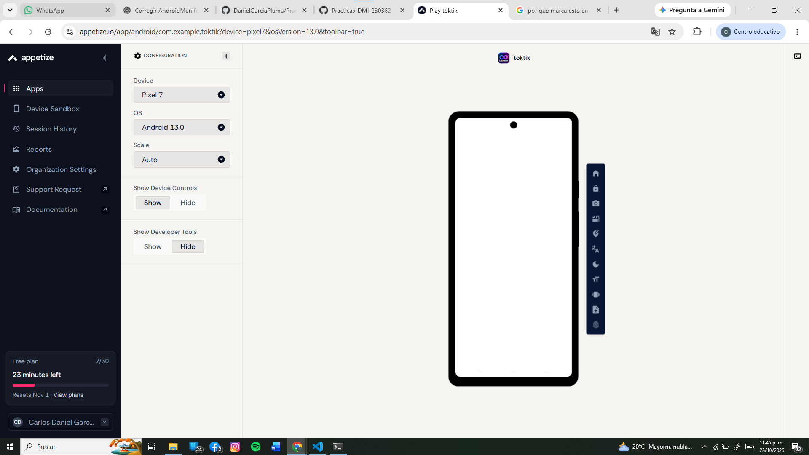</p>

### Carga de la aplicación

<p align="center">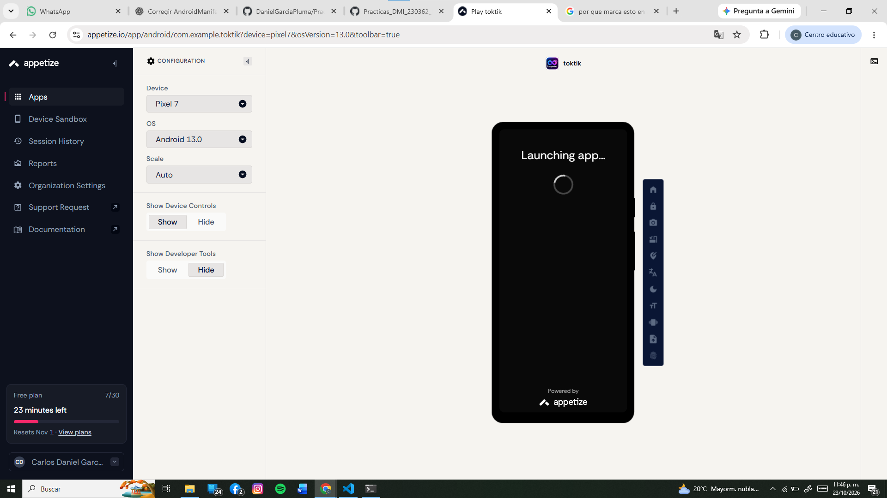</p>

### Icono en pantalla de carga

<p align="center">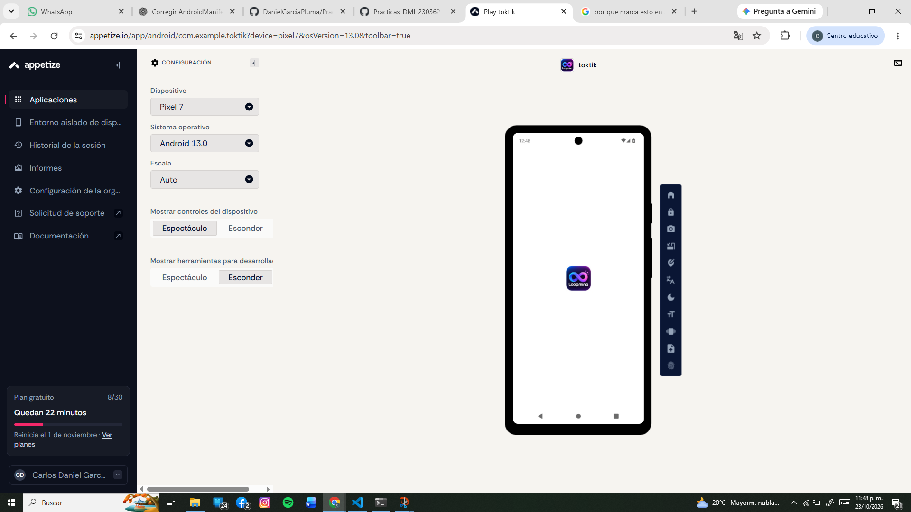</p>

### Aplicación cargando

<p align="center">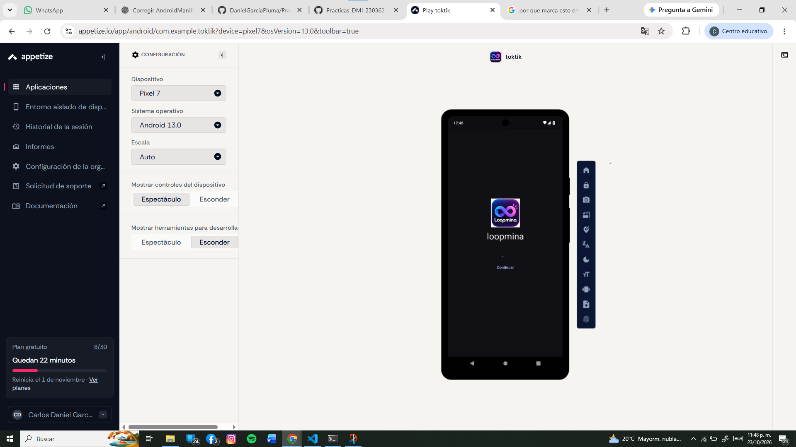</p>

### Icono en el móvil

<p align="center">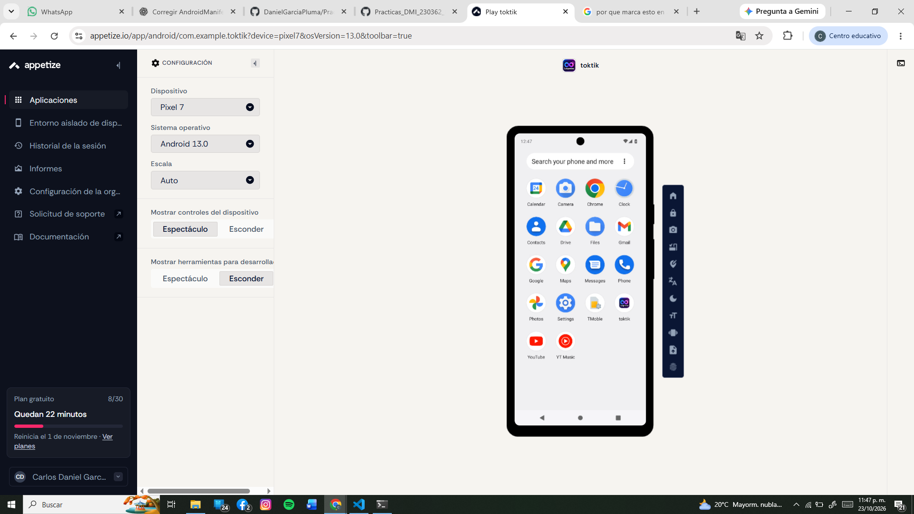</p>

#### Feeds

### Discover

<p align="center">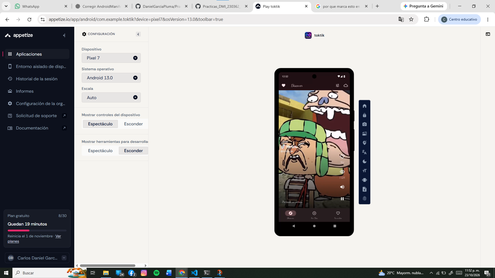</p>

### For You

<p align="center">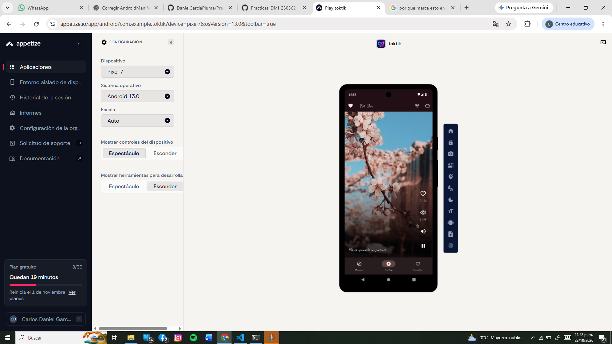</p>

### Favoritos

<p align="center">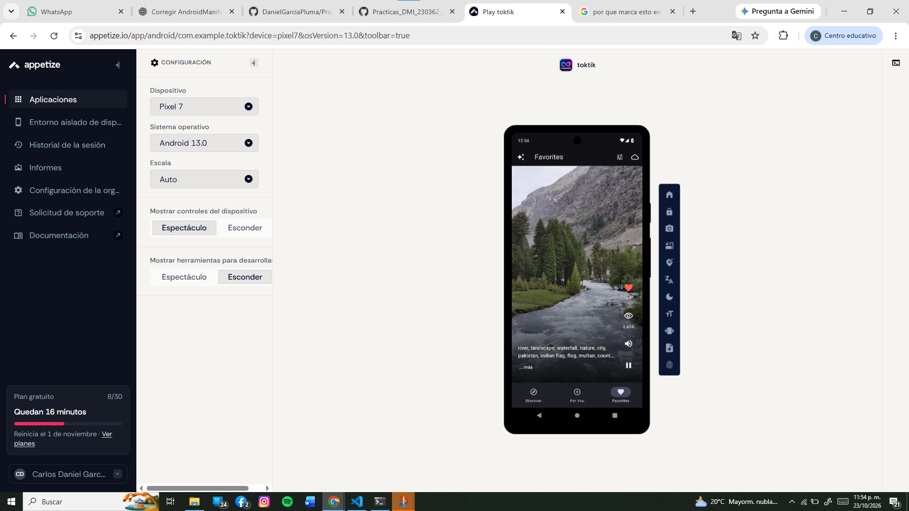</p>

#### Fuente de videos

### Aleatorio

<p align="center"></p>

### Cover

<p align="center">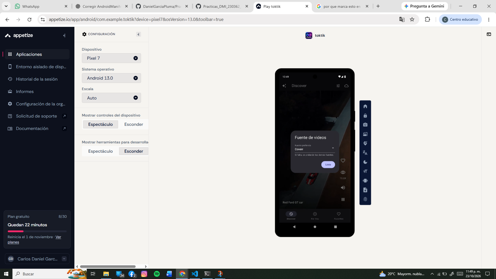</p>

### Internet Archive

<p align="center">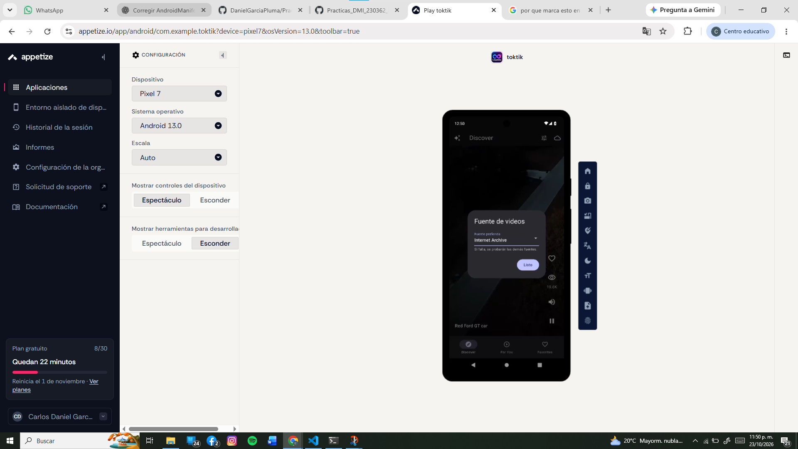</p>

### Local

<p align="center">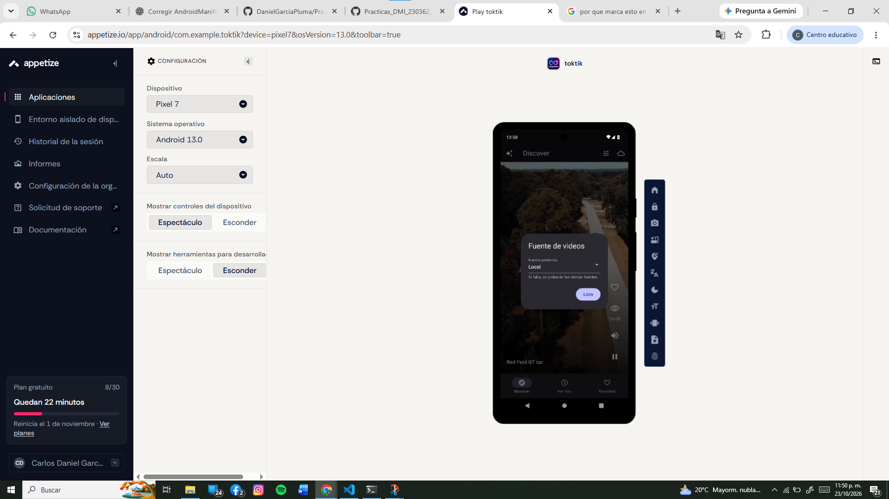</p>

### Pixabay

<p align="center">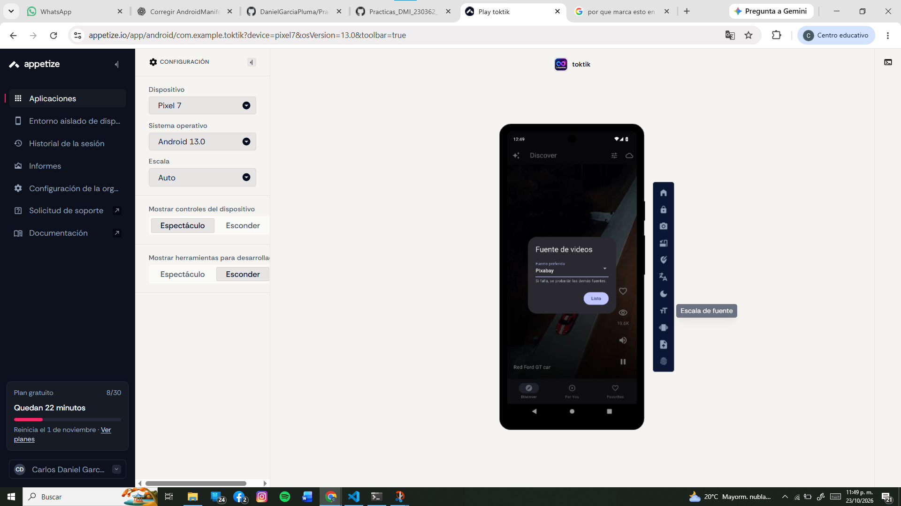</p>

#### Temas e interacciones

### Halloween

<p align="center">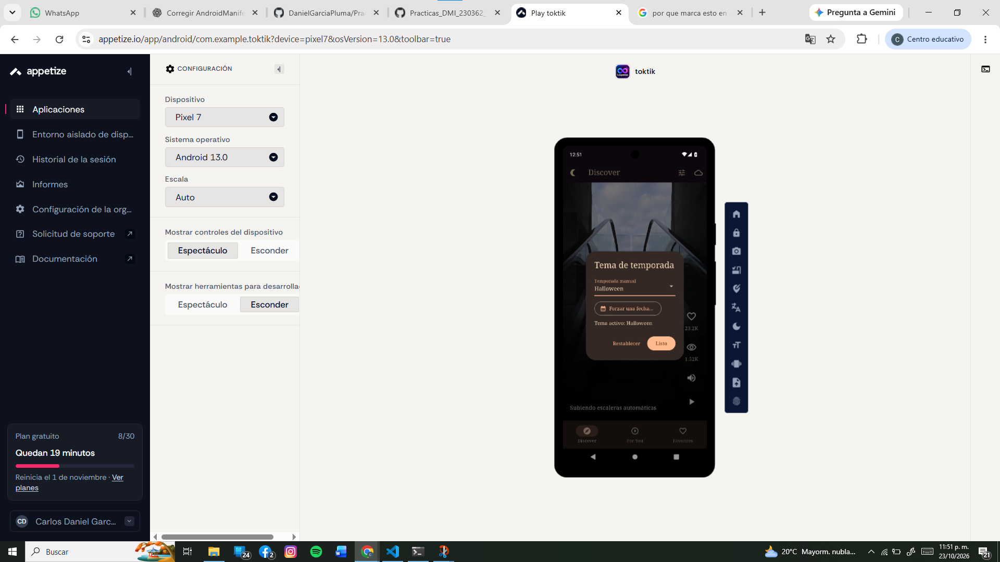</p>

### Normal

<p align="center">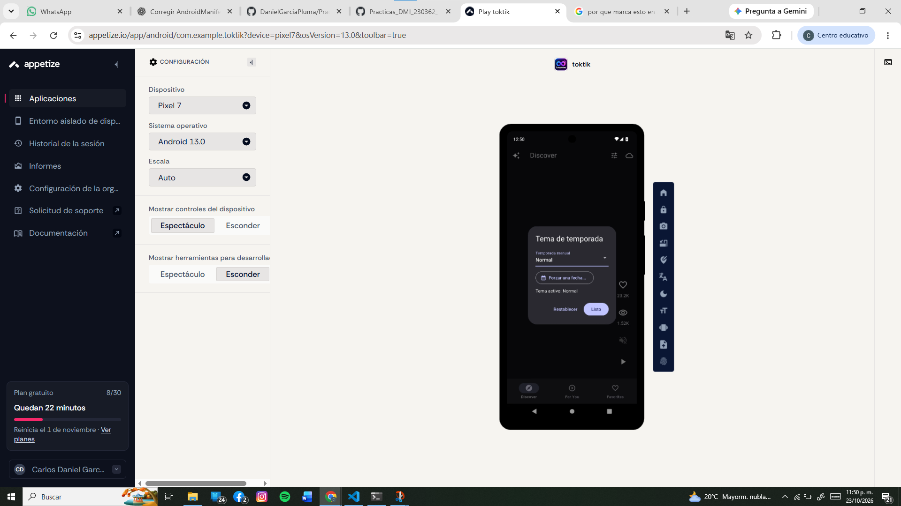</p>

### Navidad

<p align="center">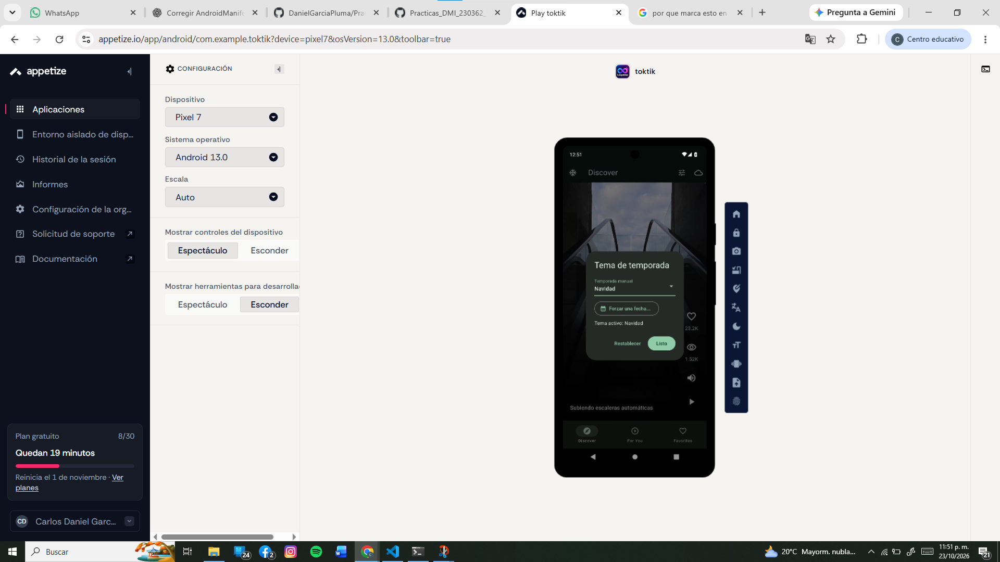</p>

### San Valentín

<p align="center"></p>

### Me gusta

<p align="center">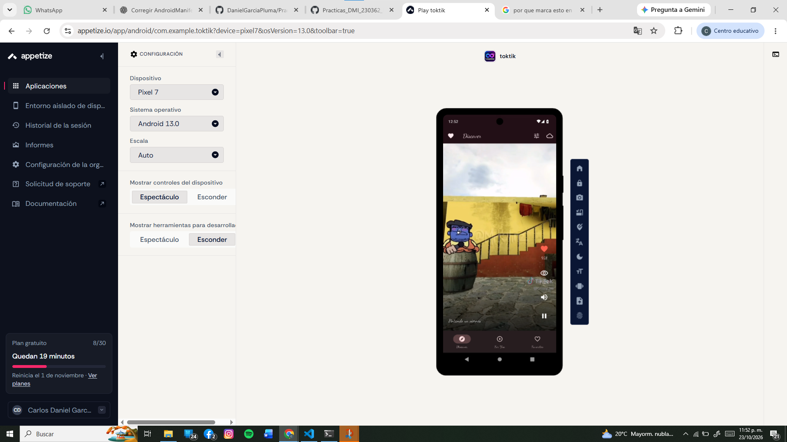</p>

### Silencio

<p align="center">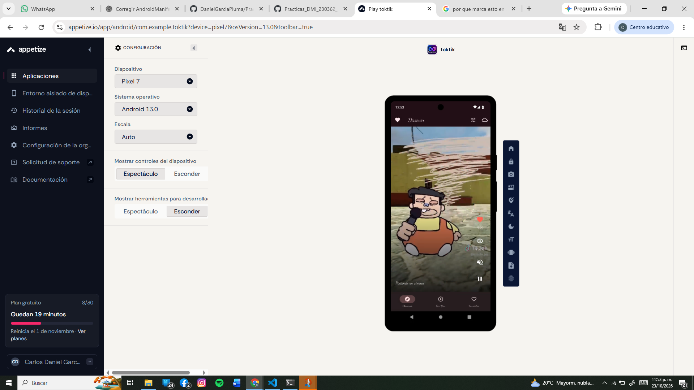</p>

### Pausa

<p align="center">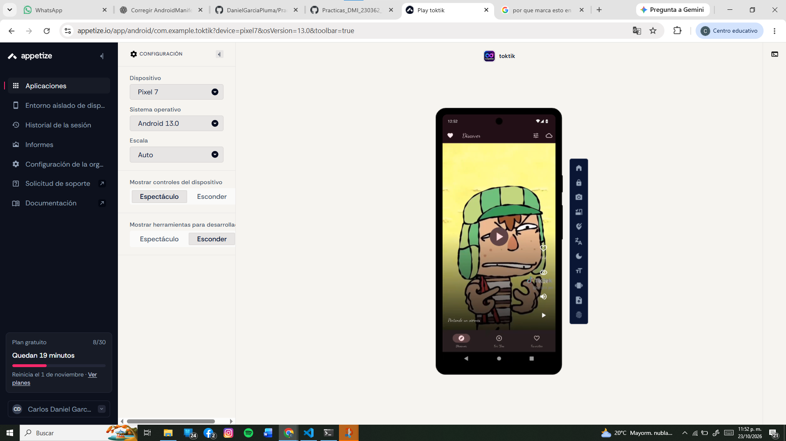</p>


## Limitaciones conocidas

- No hay videos MP4 en el checkout. Aunque pubspec.yaml declara assets/videos/ y local_video_posts.dart referencia ocho archivos, esos recursos no están presentes. La aplicación principal inicializa feeds remotos; su reproducción depende de la conexión y de que las URLs de ejemplo sigan disponibles.
- Pixabay y Pexels admiten una clave API opcional, pero main.dart crea esos datasources sin pasarla; en esa configuración usan sus catálogos de ejemplo. No se encontraron claves API en la configuración de inicio inspeccionada.
- El enlace de Appetize depende de que la aplicación siga disponible y de los permisos de acceso de la cuenta o compilación.
- No se modificaron ni verificaron desde este trabajo las grabaciones enlazadas en Google Drive; las capturas anteriores son la evidencia visual incluida directamente en este README.

## Autor

**Carlos Daniel Garcia Pluma — matrícula 230187**
**Desarrollo Móvil Integral · Ingeniería en Desarrollo y Gestión de Software**
