# Práctica 05 – Widgets App

Aplicación desarrollada con Flutter y Dart para explorar componentes de Material Design 3, navegación entre pantallas y gestión reactiva del estado.

**Datos del alumno:**

- **Nombre:** Carlos Daniel García Pluma
- **Matrícula:** 230187

---

## Descripción

Widgets App reúne ejemplos interactivos de widgets y patrones de interfaz en distintos módulos. La pantalla principal ofrece acceso a demostraciones de botones, tarjetas, indicadores de progreso, controles, animaciones, navegación y temas.

La aplicación utiliza GoRouter para la navegación y Riverpod para administrar el contador y las preferencias de apariencia.

## Objetivo

Practicar el desarrollo de interfaces con Flutter mediante componentes Material 3, navegación declarativa, gestión reactiva del estado y animaciones. Cada módulo permite explorar una función de Flutter desde una pantalla independiente.

## Tecnologías utilizadas

Las versiones corresponden a las restricciones declaradas en `pubspec.yaml`.

| Tecnología o dependencia | Versión / configuración | Uso |
|---|---|---|
| Flutter | SDK | Framework de la aplicación |
| Dart | `^3.13.3` | Lenguaje y restricción del SDK |
| Material Design 3 | `useMaterial3: true` | Componentes y tema visual |
| `go_router` | `^18.0.2` | Navegación entre pantallas |
| `flutter_riverpod` | `^2.6.1` | Estado del contador y del tema |
| `animate_do` | `^5.1.0` | Animaciones |
| `cupertino_icons` | `^1.0.8` | Iconos Cupertino |
| `flutter_test` | SDK de Flutter | Pruebas de widgets |
| `flutter_lints` | `^6.0.0` | Reglas de análisis de Dart |

## Estructura del proyecto

```text
widgets_app/
├── lib/
│   ├── assets/
│   │   └── images/                # Recursos gráficos del tutorial y carga
│   ├── config/
│   │   ├── menu/                  # Opciones de navegación
│   │   ├── router/                # Rutas de la aplicación
│   │   └── theme/                 # Colores y tema claro/oscuro
│   ├── presentation/
│   │   ├── providers/             # Estado con Riverpod
│   │   ├── screens/               # Pantallas de los módulos
│   │   └── widgets/               # Widgets reutilizables
│   └── main.dart                  # Punto de entrada
├── test/
│   └── widget_test.dart
├── pubspec.yaml
└── pubspec.lock
```

## Capturas de pantalla

Galería de evidencias de las pantallas y temas de Widgets App. Las imágenes originales están en `imagenes/`.

<table>
  <tr>
    <td align="center">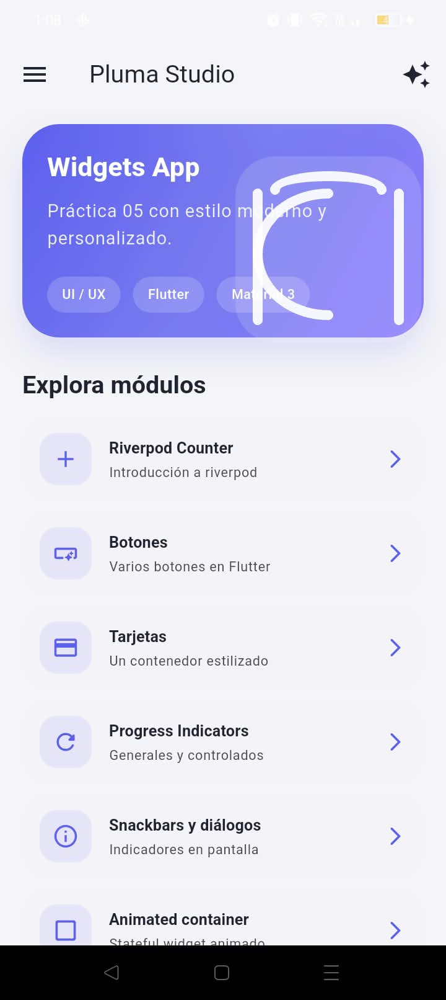<br>Inicio</td>
    <td align="center">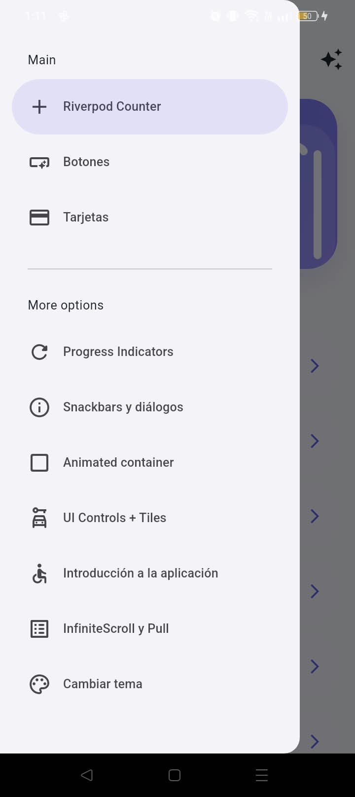<br>Menú</td>
    <td align="center">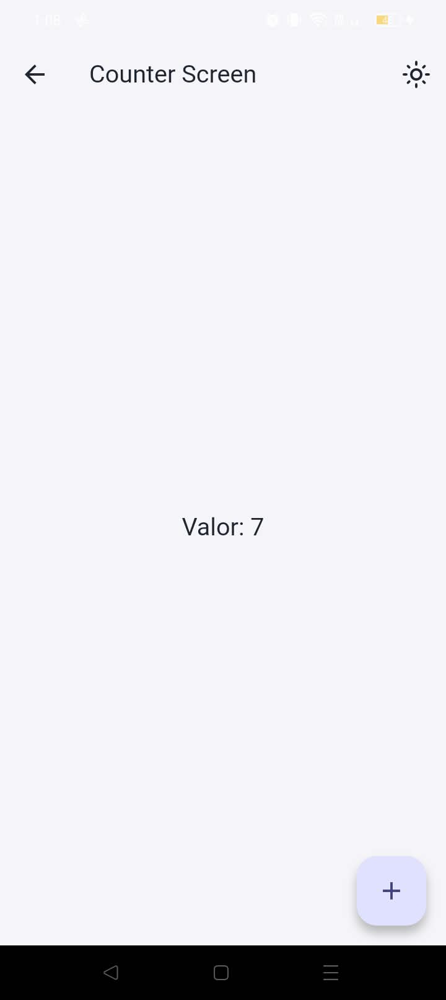<br>Contador</td>
  </tr>
  <tr>
    <td align="center">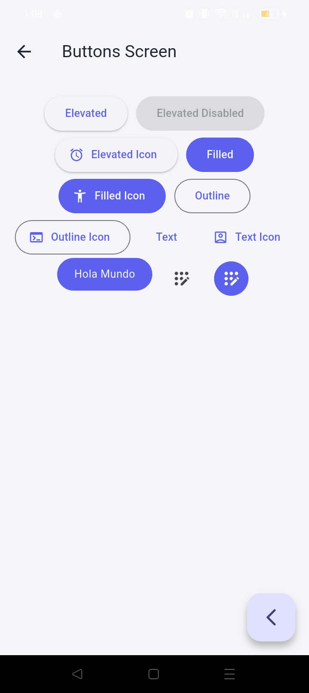<br>Botones</td>
    <td align="center">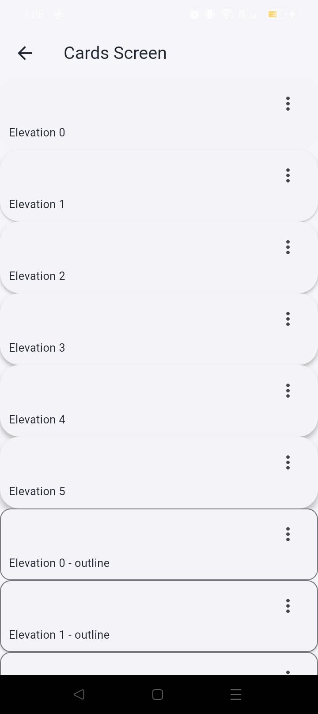<br>Tarjetas</td>
    <td align="center">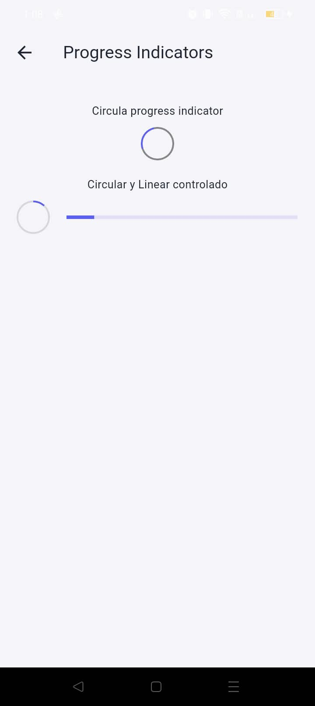<br>Progreso</td>
  </tr>
  <tr>
    <td align="center">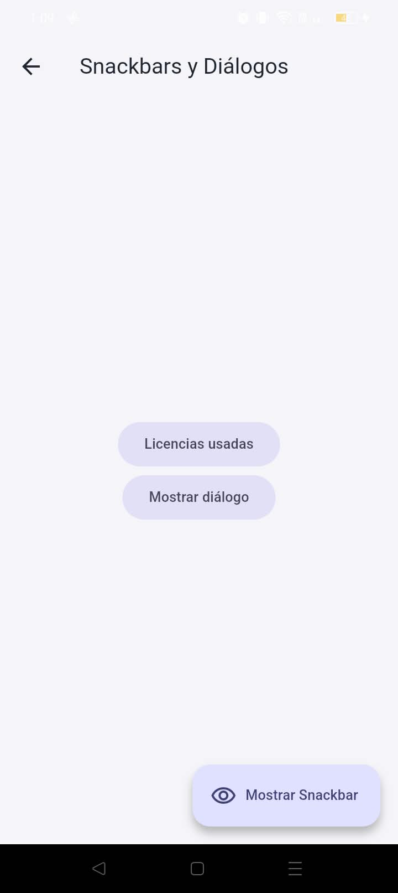<br>Snackbars y diálogos</td>
    <td align="center">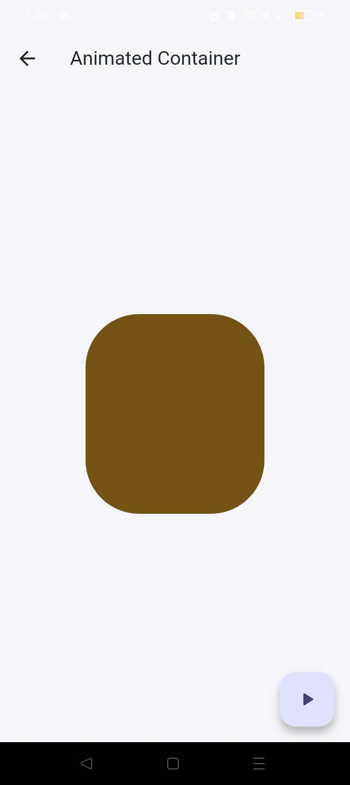<br>Animaciones</td>
    <td align="center">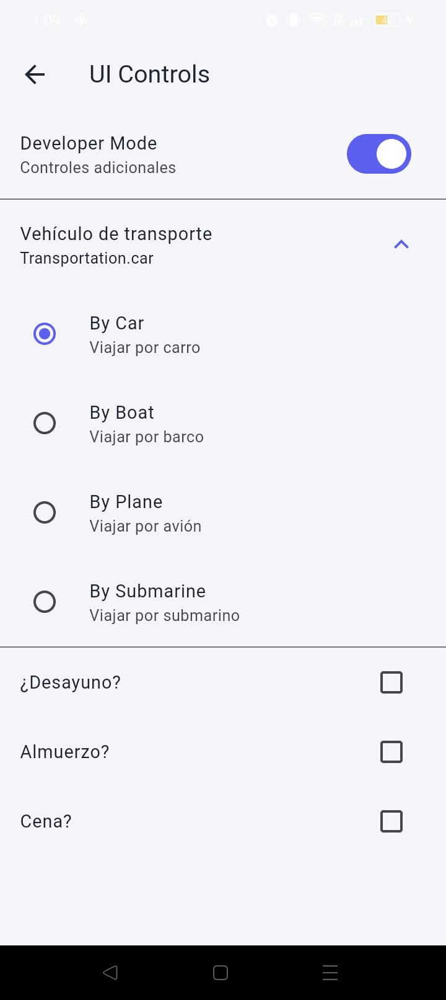<br>Controles</td>
  </tr>
  <tr>
    <td align="center">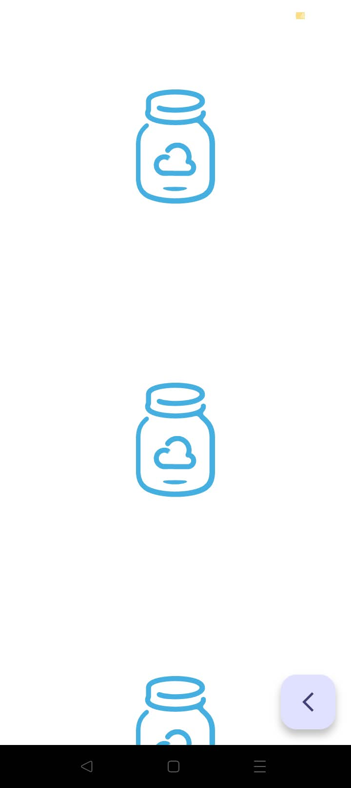<br>Desplazamiento infinito</td>
    <td align="center">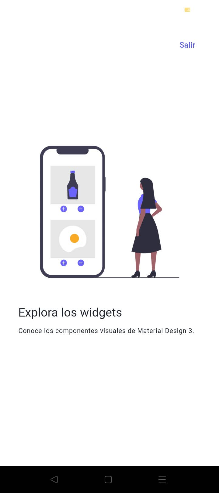<br>Tutorial</td>
    <td align="center">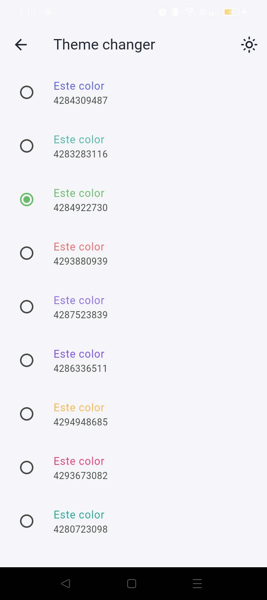<br>Selector de color</td>
  </tr>
  <tr>
    <td align="center">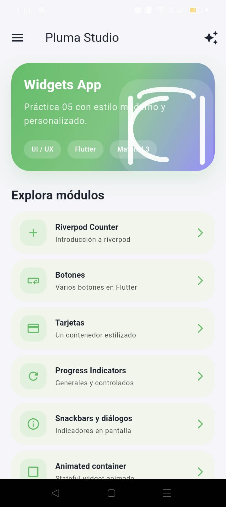<br>Inicio color seleccionado</td>
    <td align="center">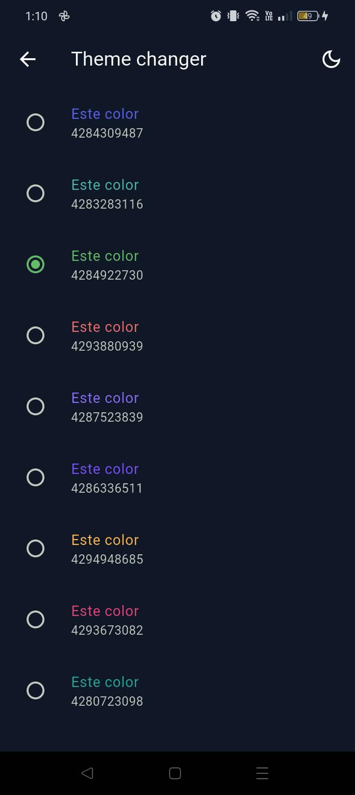<br>Selector en modo oscuro</td>
    <td align="center"><br>Inicio oscuro y color selecionados</td>
  </tr>
</table>

## Módulos y funcionalidades

- **Inicio:** catálogo visual de los módulos de la aplicación.
- **Riverpod Counter:** contador reactivo.
- **Botones:** ejemplos de botones y acciones.
- **Tarjetas:** demostraciones de tarjetas.
- **Progress Indicators:** indicadores de progreso lineales y circulares.
- **Snackbars y diálogos:** mensajes y cuadros de diálogo.
- **Animated container:** cambios animados de propiedades visuales.
- **UI Controls + Tiles:** controles interactivos y elementos de lista.
- **Introducción a la aplicación:** tutorial con recursos gráficos locales.
- **InfiniteScroll y Pull:** lista con carga progresiva y actualización por gesto.
- **Cambiar tema:** selector de color y alternancia entre tema claro y oscuro.

## Arquitectura

El proyecto separa configuración y presentación:

- **Configuración:** define el menú, el tema y las rutas.
- **Navegación:** GoRouter conecta las rutas con cada pantalla.
- **Presentación:** contiene las pantallas de los módulos y widgets reutilizables.
- **Estado:** Riverpod gestiona el contador y las preferencias del tema.
- **Recursos:** `lib/assets/images/` contiene imágenes locales usadas por la aplicación.

### Diagrama interactivo

[Ver diagrama de arquitectura de Widgets App](https://danielgarciapluma.github.io/Practicas-DMI-230187/Practica_05/widgets_app/architecture/index.html).

El archivo del diagrama está en [`architecture/index.html`](./architecture/index.html). Para que el enlace de GitHub Pages esté disponible, hay que habilitar y publicar Pages para este repositorio.

## Instalación y ejecución

Se requiere Flutter instalado y un dispositivo o emulador configurado. Desde la raíz del repositorio, ejecuta:

```powershell
cd Practica_05\widgets_app
flutter pub get
flutter run
```

Para ejecutar las pruebas:

```powershell
flutter test
```

## Conclusión

La práctica integra componentes de Material Design 3 en una aplicación modular y permite experimentar con navegación, estado reactivo, temas y animaciones usando Flutter.
